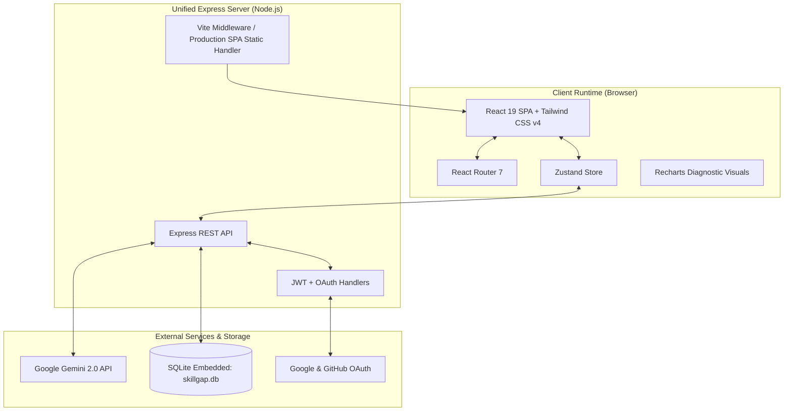
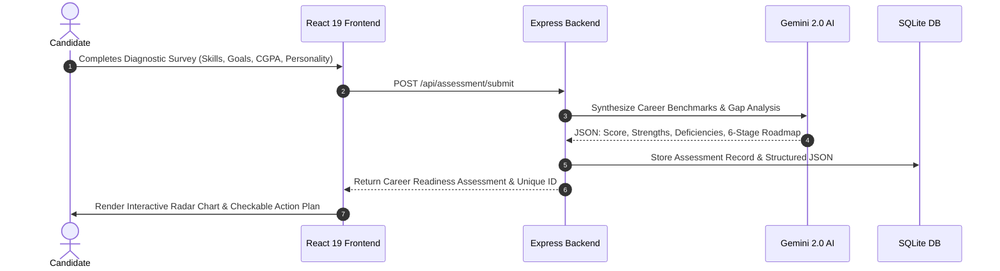

<div align="center">

# SkillGap AI: Career Readiness & Intelligent Skill Diagnostic Platform

**Full-Stack AI-Powered Assessment Platform Analyzing Career Competencies, Psychometric Alignment, and Personalized Learning Roadmaps with Google Gemini 2.0.**

[](src/)
[](tsconfig.json)
[](server.ts)
[](https://ai.google.dev)
[](render.yaml)
[](LICENSE)

</div>

---

## 1. Executive Summary

**SkillGap AI** is an intelligent career diagnostic and upskilling engine engineered for students, career switchers, and workforce development programs. Navigating the modern technology landscape requires understanding the precise delta between a candidate's current capabilities and evolving industry expectations.

SkillGap AI bridges this gap by unifying:
1. **Holistic Assessment:** Evaluates hard technical proficiencies, soft skills, academic performance (CGPA), interests, and psychometric inclinations.
2. **Generative Intelligence (Google Gemini):** Synthesizes multidimensional evaluation criteria to quantify candidate-market fit scores, uncover hidden blind spots, and generate chronological, milestone-driven learning roadmaps.
3. **Interactive Visual Analytics:** Visualizes strength/gap distributions via Recharts radar plots and progress trackers.
4. **Single-Container Hybrid Architecture:** Couples a modern React 19 single-page application with an Express TypeScript API and embedded SQLite database for zero-overhead, sub-second deployment.

---

## 2. Full-Stack System Architecture



---

## 3. Assessment & Roadmap Workflow



---

## 4. Key Capabilities & Features

- **Multidimensional Profiling:** Captures technical stack proficiencies, work personality archetypes, and academic context.
- **Dynamic Curriculum Synthesis:** Gemini AI generates customized learning milestones with recommended reading, hands-on projects, and completion estimates.
- **Interactive Action Plan:** Roadmap steps feature bidirectional completion toggling stored directly in the database (`POST /api/assessment/roadmap/toggle`).
- **Flexible Authentication:** Supports email/password authentication (salted bcrypt hash + 24-hour signed JWTs) as well as streamlined Google and GitHub OAuth 2.0 flows.
- **Embedded Zero-Config Database:** Operates via `better-sqlite3` with automated schema initialization upon server boot.

---

## 5. Quickstart & Local Execution

### Prerequisites
- Node.js 18.x, 20.x, or 22.x
- npm or pnpm
- Google Gemini API Key ([Get one at Google AI Studio](https://aistudio.google.com))

### 1. Clone & Install Dependencies
```bash
git clone https://github.com/purnachandra-maharana/skillGap.git
cd skillGap

npm install
```

### 2. Configure Environment Variables
Copy `.env.example` to `.env` and supply your credentials:
```bash
cp .env.example .env
```

```env
# Required for Gemini AI synthesis
GEMINI_API_KEY="your-gemini-api-key"

# JWT Secret for session authentication
JWT_SECRET="your-secure-random-jwt-secret-string"

# Base application URL (for OAuth callbacks)
APP_URL="http://localhost:3000"

# Optional: OAuth Integrations
GOOGLE_CLIENT_ID=""
GOOGLE_CLIENT_SECRET=""
GITHUB_CLIENT_ID=""
GITHUB_CLIENT_SECRET=""
```

### 3. Launch Development Server
```bash
npm run dev
```
Open `http://localhost:3000` in your browser. Vite runs in middleware mode with Hot Module Replacement (HMR).

---

## 6. Production Build & Deployment (Render Blueprint)

This repository includes an Infrastructure-as-Code manifest (`render.yaml`) optimized for deployment as a **Render Web Service**.

### One-Click Render Deployment
1. Push this repository to your GitHub account.
2. Sign in to your [Render Dashboard](https://dashboard.render.com).
3. Select **New +** > **Blueprint** and link this repository.
4. Render automatically configures:
   - **Environment:** Node.js
   - **Build Command:** `npm install && npm run build`
   - **Start Command:** `npm run start` (`tsx server.ts`)
   - **Health Check Path:** `/healthz`
   - **Environment Variables:** Generates a secure `JWT_SECRET` automatically. Provide your `GEMINI_API_KEY` in the Render secrets dashboard.

### Local Production Build Test
```bash
# Compile Vite frontend to dist/
npm run build

# Start production server with NODE_ENV=production
export NODE_ENV=production
npm run start
```

---

## 7. Repository Structure

```
skillGap/
├── .github/
│   └── workflows/
│       └── ci.yml             # Automated TypeScript linting & build verification
├── src/                       # React 19 SPA source code
│   ├── components/            # Reusable UI widgets & navigation
│   ├── pages/                 # Assessment, Dashboard, Auth & Roadmap views
│   ├── store/                 # Zustand state stores
│   ├── types/                 # TypeScript interface definitions
│   ├── App.tsx
│   └── main.tsx
├── .env.example               # Environment variable specification template
├── docker-compose.yml         # Container orchestration manifest
├── Dockerfile.client          # Client container definition
├── Dockerfile.server          # Server container definition
├── index.html                 # HTML template
├── package.json               # Node.js project manifest & scripts
├── render.yaml                # Render Web Service blueprint
├── server.ts                  # Express 4 + Vite SSR/SPA hybrid server
├── tsconfig.json              # TypeScript configuration
├── vite.config.ts             # Vite 6 configuration with TailwindCSS v4 plugin
└── README.md                  # Comprehensive technical documentation
```

---

## 8. Security & Privacy Disclosure

- **Credential Security:** User passwords are encrypted with bcrypt (10 salt rounds) before persistence.
- **Token Signing:** Session tokens are cryptographically signed using HS256 JWTs with a 24-hour expiration window.
- **SQL Injection Prevention:** All SQLite queries execute strictly using parameterized prepared statements via `better-sqlite3`.
- **Health Telemetry:** Built-in unauthenticated `/healthz` endpoint exposes service uptime for container orchestrator health checks.

---

## 9. Author & Attribution

**Purna Chandra Maharana**
- Portfolio: [github.com/purnachandra-maharana](https://github.com/purnachandra-maharana)
- Reference Standard: [Inkloom AI](https://github.com/purnachandra-maharana/inkloom-ai)
